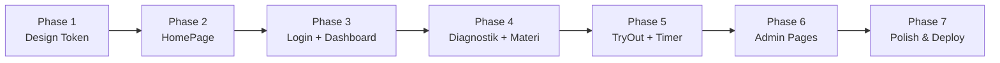

# 🌟 EduSpark v2 — Rencana Pengembangan

> Platform belajar matematika UTBK-SNBT · Neumorphism UI · React + Tailwind · Multi-page (React Router)
>
> Branch aktif: **`v2-rework`** (di-rework dari NumeracySprint)

---

## 🗂️ Scope Rework — Apa yang Berubah & Tidak

> [!IMPORTANT]
> Ini adalah **rework UI/UX + teks + nama** — bukan rewrite fitur. Struktur multi-page React Router tetap sama. Semua fitur yang ada tetap dipertahankan.

| # | Yang Berubah |
|---|---|
| 1 | **Nama & teks:** NumeracySprint → EduSpark, semua copy disesuaikan |
| 2 | **UI/UX seluruh app:** Neumorphism, latar pink terang `#F9E4EC`, aksen teal gelap `#1B6B58` |
| 3 | **Halaman baru:** `HomePage` (landing page sebelum login) — hero, mapel, paket, admin kontak |
| 4 | **ExercisePage → TryOut:** tambah **timer countdown** per sesi, rename jadi "Try Out" |
| 5 | **DiagnosticPage:** tetap ada, diubah nama display jadi "Soal Evaluasi Kemampuan" |

| # | Yang TIDAK Berubah (tetap ada) |
|---|---|
| ✅ | Struktur multi-page React Router |
| ✅ | Login page (rework UI saja) |
| ✅ | Dashboard, Diagnostik, Materi, Latihan→TryOut, About |
| ✅ | Admin: `AdminPage`, `AdminUsers`, `AdminMaterials`, `AdminExercises` |
| ✅ | Fitur CRUD materi, import soal CSV, daftar siswa berbayar/gratis |
| ✅ | Semua komponen: Navbar, BottomNav, PaywallModal, ProtectedRoute |

---

## 📁 Struktur File (Existing → Setelah Rework)

```
src/
├── pages/
│   ├── HomePage.jsx          ← 🆕 Landing page (sebelum login)
│   ├── LoginPage.jsx         ← 🎨 Rework UI saja
│   ├── DashboardPage.jsx     ← 🎨 Rework UI + teks
│   ├── DiagnosticPage.jsx    ← 🎨 Rework UI + rename "Evaluasi Kemampuan"
│   ├── MicrolearningPage.jsx ← 🎨 Rework UI + teks (EduSpark branding)
│   ├── ExercisePage.jsx      ← 🎨 Rework UI + 🆕 TIMER + rename "Try Out"
│   ├── AboutPage.jsx         ← 🎨 Rework UI + teks
│   └── admin/
│       ├── AdminPage.jsx     ← 🎨 Rework UI + teks
│       ├── AdminUsers.jsx    ← 🎨 Rework UI (tambah kolom status paket)
│       ├── AdminMaterials.jsx← 🎨 Rework UI
│       └── AdminExercises.jsx← 🎨 Rework UI
├── components/
│   ├── Navbar.jsx            ← 🎨 Rework (logo EduSpark baru)
│   ├── BottomNav.jsx         ← 🎨 Rework UI
│   ├── PaywallModal.jsx      ← 🎨 Rework UI
│   └── ProtectedRoute.jsx    ← ✅ Tidak berubah
└── index.css                 ← 🆕 Token warna neumorphism
```

---

## 🎨 Design System (dari EduSpark.md)

### Token Warna CSS
```css
:root {
  --bg: #F9E4EC;        /* Latar halaman & semua permukaan */
  --bg-deep: #F3D5E1;   /* Cekungan: input, track, timer */
  --sh-light: #FFF7FA;  /* Bayangan terang kiri-atas */
  --sh-dark: #DDB5C6;   /* Bayangan gelap kanan-bawah */
  --pink: #EFA7C1;      /* Ikon, badge, dekorasi */
  --pink-soft: #F6CADA; /* Chip, hover */
  --accent: #1B6B58;    /* Tombol utama, progress, fokus */
  --accent-dark: #124D3F; /* Hover tombol, teks timer */
  --text: #4A2A38;      /* Teks utama */
  --text-muted: #7A5566;/* Teks pendukung */
  --danger: #B04A5E;    /* Hanya jawaban salah */
}
```

### Sistem Elevasi Neumorphism
| Level | Dipakai | Box-shadow |
|---|---|---|
| Raised besar | Kartu, panel, modal | `8px 8px 18px var(--sh-dark), -8px -8px 18px var(--sh-light)` |
| Raised kecil | Tombol sekunder, chip, opsi | `4px 4px 10px var(--sh-dark), -4px -4px 10px var(--sh-light)` |
| Inset | Input, track, timer, terpilih | `inset 5px 5px 10px var(--sh-dark), inset -5px -5px 10px var(--sh-light)` |
| Tombol utama | CTA | Isi `--accent`, teks putih, shadow teal |
| Pressed | `:active` | Ganti ke inset |

### Tipografi
| Peran | Font | Ukuran |
|---|---|---|
| Judul | Fraunces 700–800 | H1 `clamp(2.6rem, 7vw, 4.7rem)` |
| Isi | Figtree 400–700 | 17px dasar |
| Timer | Share Tech Mono | 2.3rem |

---

## 📁 Struktur File (SPA, bukan multi-page)

```
src/
├── index.html              ← Single HTML file (semua section)
├── style.css               ← Token warna + komponen neumorphism
├── main.js                 ← Interaksi: tab, timer, modal, progress
└── assets/
    └── (font lokal jika perlu)
```

> [!NOTE]
> EduSpark v2 adalah **static SPA berbasis HTML/CSS/JS murni** (bukan React Router multi-page).
> Setiap "halaman" adalah section dengan anchor. Cocok untuk deploy Netlify tanpa build step.

---

## 🧩 Rincian Per Halaman

### 🆕 HomePage (Landing — sebelum login)
Rute: `/` (redirect ke `/dashboard` jika sudah login)

**Sections:**
- **Navbar** — logo EduSpark, tombol Masuk → `/login`
- **Hero** — badge `MATEMATIKA UTBK-SNBT`, headline, deskripsi, 2 CTA
- **Mata Pelajaran** — 3 kartu PK / PM / Penalaran Kuantitatif
- **Try Out Preview** — teaser fitur timer (screenshot/ilustrasi)
- **Paket** — 4 kartu Freemium (Gratis / 1bln / 3bln / 1thn)
- **Admin/Kontak** — 3 kartu admin + tombol Hubungi
- **Footer** — © 2026 EduSpark

### 🎨 LoginPage → Rework UI saja
- Desain neumorphism, warna token baru
- Teks: "Masuk ke EduSpark"
- Logika & form tetap sama

### 🎨 DashboardPage → Rework UI + teks
- Sapaan: "Halo, [Nama]! 👋" → ikon SVG
- Kartu navigasi: Evaluasi Kemampuan, Materi, Try Out, Tentang
- Branding EduSpark di header

### 🎨 DiagnosticPage → Rework UI + rename display
- Judul tampil: **"Evaluasi Kemampuan"** (bukan "Diagnostik")
- 3 soal pilihan ganda tetap ada
- Logika skor & level (Dasar/Menengah/Lanjut) tetap sama
- UI neumorphism: opsi jawaban raised → terpilih inset

### 🎨 MicrolearningPage → Rework UI + teks
- Nama topik disesuaikan ke konteks UTBK (PK/PM/PKu)
- Accordion/expand neumorphism
- Paywall card rework (tombol WhatsApp tetap)

### 🆕🎨 ExercisePage → **TryOut + Timer**
- Rename tampilan: **"Try Out"**
- Tambah **timer countdown** per sesi (konfigurasi durasi di data soal)
- Timer: Share Tech Mono, `--accent-dark`; sisa <10 detik → `--danger`
- Timer mulai saat tombol **Mulai Try Out** ditekan
- Waktu habis → auto submit + "Waktu habis!"
- UI soal neumorphism (opsi raised → inset saat dipilih)
- Logika soal, feedback, pagination tetap sama

### 🎨 AdminPage & sub-pages → Rework UI
- **AdminUsers:** tambah kolom **Status Paket** (Gratis/Berbayar) di tabel siswa
- **AdminMaterials:** UI neumorphism, form raised/inset
- **AdminExercises:** UI neumorphism, import CSV tetap ada

---

## 🗓️ Fase Pengembangan



### Phase 1 — Design Token & Global Style
- [ ] Update `index.css` dengan CSS custom properties neumorphism
- [ ] Import Google Fonts: Fraunces, Figtree, Share Tech Mono
- [ ] Buat utility Tailwind class atau CSS class: `.raised`, `.raised-sm`, `.inset`, `.btn-accent`, `.btn-secondary`
- [ ] Update `tailwind.config.js` dengan warna token EduSpark

### Phase 2 — HomePage (Baru)
- [ ] Buat `src/pages/HomePage.jsx`
- [ ] Tambah route `/` di `App.jsx` (redirect ke `/dashboard` jika sudah login)
- [ ] Section: Navbar mini, Hero, Mapel 3 kartu, Paket 4 kartu, Admin kontak, Footer

### Phase 3 — Login + Dashboard
- [ ] `LoginPage.jsx` — rework UI neumorphism, teks "Masuk ke EduSpark"
- [ ] `DashboardPage.jsx` — rework kartu navigasi, branding baru
- [ ] `Navbar.jsx` — logo EduSpark (Edu/Spark dua warna + orb teal)
- [ ] `BottomNav.jsx` — rework ikon & warna

### Phase 4 — Diagnostik + Materi
- [ ] `DiagnosticPage.jsx` — rename display "Evaluasi Kemampuan", UI neumorphism
- [ ] `MicrolearningPage.jsx` — rework accordion, topik UTBK, paywall UI

### Phase 5 — TryOut + Timer
- [ ] `ExercisePage.jsx` → rename tampilan "Try Out"
- [ ] Tambah state `timer` + `isStarted`
- [ ] Tombol **Mulai Try Out** → mulai countdown
- [ ] Display timer (Share Tech Mono)
- [ ] Auto-submit jika timer = 0
- [ ] UI soal neumorphism

### Phase 6 — Admin Pages
- [ ] `AdminPage.jsx` — rework dashboard admin
- [ ] `AdminUsers.jsx` — tambah kolom status paket, rework tabel
- [ ] `AdminMaterials.jsx` — rework form
- [ ] `AdminExercises.jsx` — rework form + import CSV tetap

### Phase 7 — Polish & Deploy
- [ ] Cek responsif mobile semua halaman
- [ ] Aksesibilitas: `aria-label`, focus-visible outline `--accent`
- [ ] Smooth transition antar halaman
- [ ] Build & verifikasi `dist/`
- [ ] Push ke `origin/v2-rework` → Netlify preview

---

## ⚡ Perintah Dev

```bash
# Pastikan di branch v2-rework
git checkout v2-rework
npm run dev
```

---

## ✅ Keputusan yang Sudah Dikonfirmasi

| Keputusan | Nilai |
|---|---|
| Timer Try Out | **2 menit per soal**, countdown, auto submit saat habis |
| Status paket siswa | **Toggle manual admin** di AdminUsers |
| Penyimpanan data | **Netlify Functions + Netlify DB** (bukan localStorage) |
| Kontak admin di HomePage | **Dikonfigurasi dari Admin Dashboard** (AdminTeam) |
| Semua ikon & emoji | **Ganti semua ke Phosphor Icons SVG** (`@phosphor-icons/react`) |
| Struktur app | **React Router multi-page** (tidak diubah) |

---

## 🔴 Masalah yang Masih Terbuka

| Prioritas | Masalah |
|---|---|
| 🔴 | Materi lengkap (isi bab PK/PM/PKu) belum ditulis |
| 🔴 | Pembayaran belum ada (prototipe: simulasi saja) |
| 🟡 | Perbedaan evaluasi gratis vs berbayar belum didefinisikan secara konten |
| 🟡 | Catatan "Prototipe: ..." perlu dihapus saat rilis |
